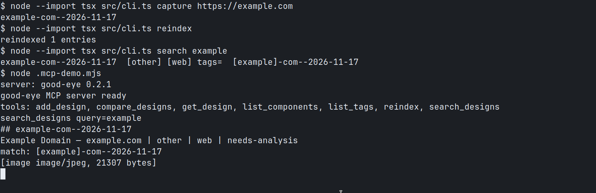

# good-eye

good-eye is a local design library for people who design interfaces with Claude or Codex. It stores screenshots and page tokens for a site or app, can keep component crops, and can use the claude CLI to add a palette, typography, and a written review. An MCP server searches that library.



## Quick start

Node.js 20 or newer.

```sh
git clone https://github.com/glebstarchikov/good-eye.git
cd good-eye
npm ci
npx playwright install chromium
node --import tsx src/cli.ts capture https://example.com
node --import tsx src/cli.ts reindex
node --import tsx src/cli.ts search example
```

Nothing reads a `.env` file. The catalog defaults to `~/.good-eye/data`. Set `GOOD_EYE_DATA_DIR` to put it somewhere else.

On 17 November 2026 that printed:

```
example-com--2026-11-17
reindexed 1 entries
example-com--2026-11-17  [other] [web] tags=  [example]-com--2026-11-17
```

The screenshot's last command is a small MCP client started on this machine. It connects to `src/server.ts` over stdio, lists the seven tools, and calls `search_designs`. The reply is the entry text plus a JPEG thumbnail.

`capture` writes `meta.json`, `desktop.png`, `desktop-fold.png`, `mobile.png`, `tokens.json`, `page.html`, and `styles.css` under `~/.good-eye/data/designs/<slug>/`. The slug includes the capture date. A second capture of the same site on the same day stops unless you pass `--force`. Status stays `needs-analysis` until a review is written. `search` still finds the entry. `reindex` rebuilds `~/.good-eye/data/catalog.db` from those files.

`add` and `analyze` send the captured files to the claude CLI and store the review in `analysis.md`. `GOOD_EYE_CLAUDE_BIN` selects that binary (default `claude`) and `GOOD_EYE_MODEL` selects the model (default `sonnet`). A folder of your own screenshots can be added with `node --import tsx src/cli.ts add --folder <dir> --name <name> --platform ios|android|macos|web`. App Store and Play Store URLs go through `add` as well. CI does not call Claude.

To register the server with Claude Code, symlink `skills/good-eye` into `~/.claude/skills/good-eye`, and install the design-prompt hook:

```sh
bash scripts/install.sh
```

That needs the `claude` CLI on `PATH`. The hook prints a one-line reminder when a prompt looks like design work. The script also prints snippets for Claude Desktop (`claude_desktop_config.json`) and Codex (`~/.codex/config.toml`). The server itself is `npm run server` (`node --import tsx src/server.ts`). It speaks MCP over stdio and logs `good-eye MCP server ready` on stderr. The tools are `search_designs`, `get_design`, `list_components`, `compare_designs`, `list_tags`, `add_design`, and `reindex`.

There is no compile step. `npm run typecheck` and `npm test` are the checks. Tests launch Playwright against local fixtures, so Chromium has to be installed first.

## Stack

TypeScript on Node.js, run with tsx. The MCP server uses `@modelcontextprotocol/sdk`. Search is SQLite FTS5 through `better-sqlite3`. Page capture uses Playwright. Images use Sharp, palettes use node-vibrant, and records are checked with zod. Tests use `node:test`.

## Status

November 2026. Version 0.2.1.

## License

[MIT](LICENSE)

More at [glebstarchikov.nl](https://glebstarchikov.nl).
