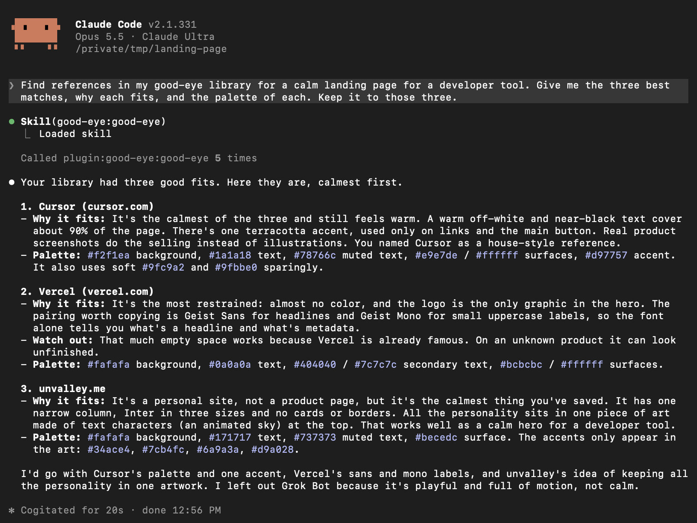

# good-eye

A personal design-inspiration database, searchable by Claude through MCP.



Instead of scrolling through bookmarks when a project needs a design direction, good-eye keeps full-page screenshots, component crops, palettes, typography, and a written review for every site or app worth stealing from. Claude (Code, Desktop) and Codex can search it directly through the `good-eye` MCP server, so design inspiration shows up automatically while designing something rather than requiring a manual lookup.

## Stack
TypeScript, Node.js, the Model Context Protocol SDK, SQLite (FTS5), Playwright, Sharp.

## Getting started
```sh
claude plugin marketplace add glebstarchikov/claude-plugins
claude plugin install good-eye@glebstarchikov
```

This installs the MCP server and the skill as a Claude Code plugin. There is no hook. For Claude Desktop and Codex, `bash scripts/install.sh --dry-run` prints config snippets.

The review of each design is written by `claude -p`, run without your settings files, so it signs in through `claude login` or real environment variables. Auth set only in `~/.claude/settings.json` (`apiKeyHelper`, `env`) won't reach it.

Add a design: tell Claude "add https://stripe.com to the design library, look at their pricing" (or run `node --import tsx src/cli.ts add <url> --note "..."` from the repo). You can also paste an App Store or Play Store link, or ingest a folder of screenshots.

Search happens when design-factory's references step asks for it, or when you ask Claude to look something up. To search manually: `node --import tsx src/cli.ts search dark pricing --tag dark-mode`.

Layout:
- `~/.good-eye/data/designs/<slug>/` (or `$GOOD_EYE_DATA_DIR`) holds `meta.json`, `analysis.md`, screenshots, and tokens (the source of truth, outside the repo)
- `~/.good-eye/data/catalog.db` is a derived SQLite/FTS5 index (`cli.ts reindex` rebuilds it)
- `src/` holds the capture pipeline, librarian, CLI, and MCP server; `skills/` and `scripts/` hold the rest

## Status
Active, November 2026.

## License
MIT

---
Part of what I build at [glebstarchikov.nl](https://glebstarchikov.nl).
